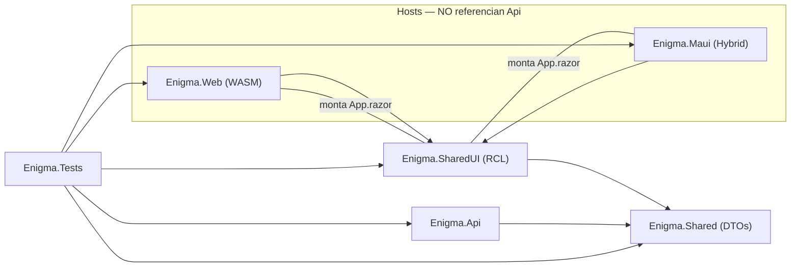
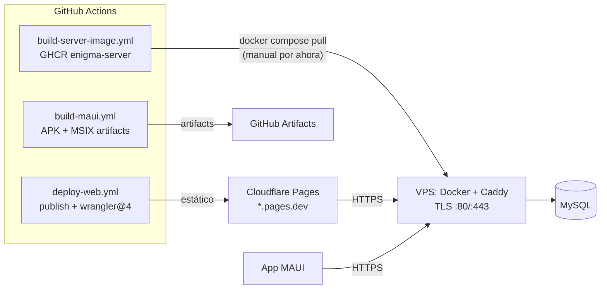

# Diseño: Monorepo Web + MAUI + API (paridad Build-It)

**Fecha:** 2026-11-04 · **Rama:** `feat/monorepo-web-maui-api` · **Estado:** aprobado
**Referencias:** [`docs/superpowers/specs/`](.), repo `Agustin-Gigena/Build-It` rama `feat/arquitectura-monorepo` (patrón de origen), `AGENTS.md`, `PRODUCT.md`, `DESIGN.md`.

## 1. Objetivo

Convertir Enigma en un sistema **Web + MAUI + API** con la arquitectura de Build-It: un solo frontend lógico (UI en RCL compartida), dos hosts (Blazor WASM y Blazor Hybrid), un backend REST, y layout de monorepo `src/` + `tests/`.

### No-objetivos (explícitos)

- Sistema de menús (feature posterior sobre esta base; rama `feat/menusystem` queda reservada).
- Migrar auth a OpenIddict (Build-It declara el paquete sin usarlo; Enigma mantiene Identity + JWT, que ya está end-to-end con tests).
- Deploy automatizado a la instancia / Play Store / firma MSIX.
- Refactor async de `GenericRepository`.
- iOS/MacCatalyst (decisión: Android + Windows).

### Decisiones tomadas (con el usuario)

| Decisión | Elección |
|---|---|
| Estructura | Paridad total Build-It: `src/` + `tests/`, renombres de proyectos y namespaces |
| Alcance | Solo reestructurar; menús después |
| Plataformas MAUI | Android + Windows (windows TFM condicionado a host Windows; CI en `windows-latest`) |
| Tests | UN solo proyecto para todo (Api+Web+Maui+SharedUI+Shared), NUnit |
| Auth | Se mantiene Identity + JWT bearer |
| Deploy | API: Docker+Caddy en VPS · Web: estático en Cloudflare Pages · MAUI: APK + instalador Windows (artifacts) |

## 2. Estructura de la solución

```
Enigma.slnx                      ← 6 proyectos
Enigma.Core.slnf                 ← filtro: Api+Web+Shared+SharedUI+Tests (sin Maui, para CI ubuntu)
global.json                      ← banda SDK 10.x fija
Directory.Build.props            ← net10.0, nullable, implicit usings comunes
Directory.Packages.props         ← CPM + CentralPackageTransitivePinningEnabled=true
src/
├── Enigma.Api/                  ← ex Server/ (git mv) · ns Enigma.Server.* → Enigma.Api.* · Dockerfile
├── Enigma.Web/                  ← ex Client/ (git mv), host WASM fino · ns Enigma.Client.* → Enigma.Web.* · Dockerfile
├── Enigma.SharedUI/             ← NUEVO RCL · ns Enigma.SharedUI.*
├── Enigma.Maui/                 ← NUEVO Blazor Hybrid · ns Enigma.Maui.*
└── Enigma.Shared/               ← se mueve a src/ (sin cambios internos)
tests/
└── Enigma.Tests/                ← ex Tests/ (git mv, csproj renombrado a Enigma.Tests.csproj)
deploy/
├── docker-compose.yml           ← stack VPS: api + mysql + caddy
└── Caddyfile                    ← reverse proxy TLS
```

Todos los movimientos con `git mv` (preserva historia).

### Regla de dependencias (exigida por ArchitectureTests)



- Nadie referencia `Enigma.Api` excepto `Enigma.Tests`. Regla nueva en `ArchitectureTests`.
- `SharedUI` solo conoce `Shared` (DTOs) e `HttpClient` inyectado.

### Central Package Management

- `Directory.Packages.props` con `ManagePackageVersionsCentrally=true` + `CentralPackageTransitivePinningEnabled=true` (patrón Build-It).
- Fija transitivos con CVE: `System.Security.Cryptography.Pkcs` 10.0.x, `System.Security.Cryptography.Xml` 10.0.x; bump de `Microting.EntityFrameworkCore.MySql` (hoy 10.0.9, arrastra MySqlConnector 2.6.0 con NU1902) a la última 10.x estable verificando el ejecutable MySqlConnector resultante.
- Objetivo: `dotnet list Enigma.slnx package --vulnerable` sin salida (gate existente de pr-validation).

## 3. Enigma.SharedUI (extracción de UI)

Nueva RCL (`Microsoft.AspNetCore.Components.Web`). Se mueve desde `Client/`:

| Elemento | Destino |
|---|---|
| `App.razor` (Router — `AppAssembly` pasa a `typeof(App).Assembly` de SharedUI) | raíz RCL |
| `Pages/` (Login, SeleccionInstitucion, Home, NotFound, RedirectToLogin) + `.razor.css` | `Pages/` |
| `Layout/` (AuthLayout, MainLayout) + `.razor.css` | `Layout/` |
| `Shared/PanelVivo.razor` + css | `Shared/` |
| `Services/` (AuthService, CookieHandler, EnigmaAuthenticationStateProvider, ThemeService) | `Services/` |
| `wwwroot/css/app.css`, `wwwroot/fonts/`, `wwwroot/js/login-motion.js`, `lib/bootstrap/` | `wwwroot/` → servido como `_content/Enigma.SharedUI/…` |
| `_Imports.razor` (ajustado a ns SharedUI) | raíz |

- **Registro único:** `AddEnigmaSharedUI(IServiceCollection)` registra los 4 servicios + `AuthorizationCore` + `AuthenticationStateProvider`. El host registra su `HttpClient` (con `CookieHandler`) ANTES y luego llama la extensión.
- Los servicios conservan comportamiento exacto (JWT localStorage, cookie, tema) — el JS interop funciona igual en `BlazorWebView`.

## 4. Hosts

### Enigma.Web (WASM)

- `Program.cs`: root components (`SharedUI.App` + HeadOutlet), `HttpClient` con base `ServerUri` (`wwwroot/appsettings.json`), `AddEnigmaSharedUI()`.
- `wwwroot/` queda PWA-only: `index.html` (shell, tema pre-render, loading screen; links → `_content/Enigma.SharedUI/…`; bundle `Enigma.SharedUI.styles.css`), `manifest.webmanifest`, `service-worker*.js`, `images/`.
- El scoped CSS de la RCL se empaqueta en el bundle del host WASM automáticamente.

### Enigma.Maui (Blazor Hybrid)

- csproj: `net10.0-android` + `net10.0-windows10.0.19041.0` condicionado a `IsOSPlatform('windows')`; `SupportedOSPlatformVersion`: android 24, windows 10.0.17763.0. Linux buildea Android; Windows solo en hosts Windows.
- `MauiProgram.cs`: `HttpClient` (base desde `appsettings.json` embebido — `10.0.2.2:8081` emulador; **la Api es :8081**) + `AddEnigmaSharedUI()`.
- `MainPage.xaml`: `BlazorWebView` + `<RootComponent Selector="#app" ComponentType="{x:Type sharedUI:App}" />`.
- `wwwroot/index.html` propio: shell mínimo con script de tema pre-render, CSS de `_content/Enigma.SharedUI/` y **`_content/Enigma.SharedUI/Enigma.SharedUI.bundle.scp.css`** (en MAUI el scoped CSS de la RCL NO se auto-empaqueta — lección Build-It).
- `Platforms/Android/` mínimo (MainActivity, MainApplication, iconos).
- CORS: sin cambios (HTTP nativo). Auth: mismo JWT localStorage (persistente en WebView); `SecureStorage` queda como follow-up explícito.

### Enigma.Api

- Rename puro: carpeta, csproj, namespaces (`Enigma.Server.*` → `Enigma.Api.*`). Comportamiento intacto.
- Sumas chicas para el deploy objetivo: middleware `ForwardedHeaders` (detrás de Caddy) y CORS por configuración (`ENIGMA_CORS_ORIGINS`, acepta el dominio Pages en prod).

## 5. Tests (`tests/Enigma.Tests/`)

- Un solo proyecto NUnit referenciando los 5. Los 59 tests se conservan verbatim salvo namespaces/paths.
- `E2EWebFixture`: refs a `Program` de Api y assets de Web con nombres nuevos. Los 6 E2E son la verificación del cutover (con MySQL arriba).
- `ArchitectureTests`: nueva regla "nadie referencia Enigma.Api".
- `stryker-config.json`, `mutation.run.sh`, `coverage.run.sh`: paths actualizados, umbrales 100/90/80 intactos.

## 6. Deploy



- **API (VPS):** se conserva `build-server-image.yml` (path del Dockerfile actualizado). `deploy/docker-compose.yml` + `deploy/Caddyfile` versionados; deploy a la instancia manual por ahora (`docker compose pull && up -d`).
- **Web (Pages):** nuevo `deploy-web.yml` (`workflow_dispatch`): publish → `wrangler@4 pages deploy dist/wwwroot`. Lecciones Build-It obligatorias: wrangler 4 (no 3.x), verificar bundle CSS de la RCL post-publish (rehash/reescritura si hace falta), `_redirects` solo rutas explícitas SIN catch-all (rompe `_framework/`), `404.html` presente desactiva el fallback SPA automático. Auditoría del placeholder `#[.{fingerprint}]` en `index.html` (una sola ocurrencia, nunca en comentarios HTML).
- **MAUI (artifacts):** `build-maui.yml`: job ubuntu (`maui-android`) → APK; job `windows-latest` (`dotnet workload install maui-windows`) → publish self-contained + MSIX sin firmar (sideload; firma = follow-up). Sin store.
- **Obsoleto:** `build-client-image.yml` se ELIMINA (la Web es estática; ya no hay imagen del client).

**CI de validación:** `pr-validation.yml` buildea `Enigma.Core.slnf` (sin Maui → ubuntu sin workload MAUI). Maui lo cubren los jobs dedicados. `dev-db-image.yml` y `apply-rulesets.yml` intactos.

## 7. Tooling y devcontainer

- `start-dev.sh`/`setup.sh`: paths `Server→src/Enigma.Api`, `Client→src/Enigma.Web`; instalación del workload `maui-android` (lefthook pre-commit buildea el slnx completo).
- `global.json`: banda SDK 10.x (paridad Build-It).
- `lefthook.yml`, `.yamllint`, `scripts/`: intactos salvo verificación de paths.
- Docs al cierre del cutover: `AGENTS.md`, `README.md`, `PRODUCT.md` (Operating Context), `DESIGN.md`.

## 8. Riesgos y verificación

| Riesgo | Mitigación |
|---|---|
| Bundle scoped CSS RCL con hash no reescrito en publish | Check post-publish del CSS en `deploy-web.yml` (rewrite si aplica) |
| Fingerprint `#[.{fingerprint}]` duplicado en comentarios | Auditoría de `index.html` en la extracción |
| `E2EWebFixture` roto por estructura nueva | Correr los 6 E2E con MySQL como gate del cutover |
| Residuos de namespaces viejos | `grep` de verificación + CI verde |
| MySqlConnector CVE persiste | `dotnet list package --vulnerable` vacío al cierre |
| localStorage evictable en WebView Android | Aceptado (YAGNI); follow-up `SecureStorage` |

## 9. Orden de implementación (cada paso: build verde + tests pasando)

1. **Renames + namespaces + CPM:** git mv `Server→src/Enigma.Api`, `Client→src/Enigma.Web`, `Shared→src/Enigma.Shared`, `Tests→tests/Enigma.Tests`; codemod namespaces; `Directory.Build.props`, `Directory.Packages.props`, `global.json`, `Enigma.slnx` actualizado.
2. **Extracción SharedUI:** crear RCL, mover UI + servicios + assets, `AddEnigmaSharedUI()`, Web host fino. Web funciona idéntico.
3. **Host MAUI:** csproj Android+Windows, MauiProgram, MainPage, index.html propio, Platforms/Android.
4. **CI/Deploy:** slnf, `build-maui.yml`, `deploy-web.yml`, paths de `build-server-image.yml`, eliminar `build-client-image.yml`, `deploy/` (compose + Caddyfile), ForwardedHeaders + CORS por config en Api, devcontainer/scripts.
5. **Cutover:** E2E completo con MySQL, `dotnet list package --vulnerable` limpio, docs actualizadas (AGENTS/README/PRODUCT/DESIGN).

## 10. Metodología de ejecución

Loop de subagentes por paso (metodología "Ralph"): cada paso se ejecuta con un agente que recibe SIEMPRE el mismo prompt-plantilla — contexto del repo + spec + su paso + obligación de verificar (build + tests relevantes) y no terminar hasta que verifique. Un solo agente por paso (edits de alta contención); verificación por el orquestador entre pasos; el paso siguiente no arranca sin el gate verde del anterior.
